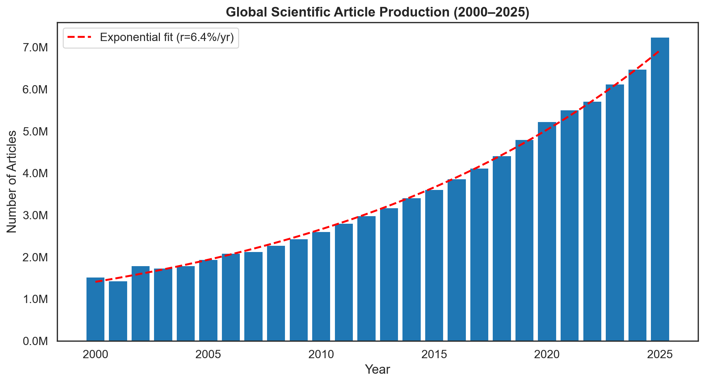
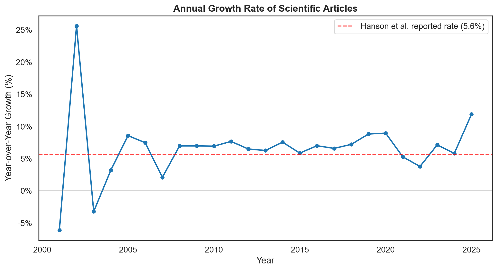
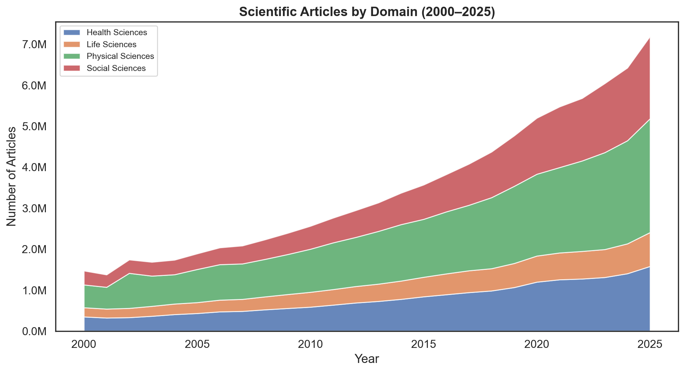
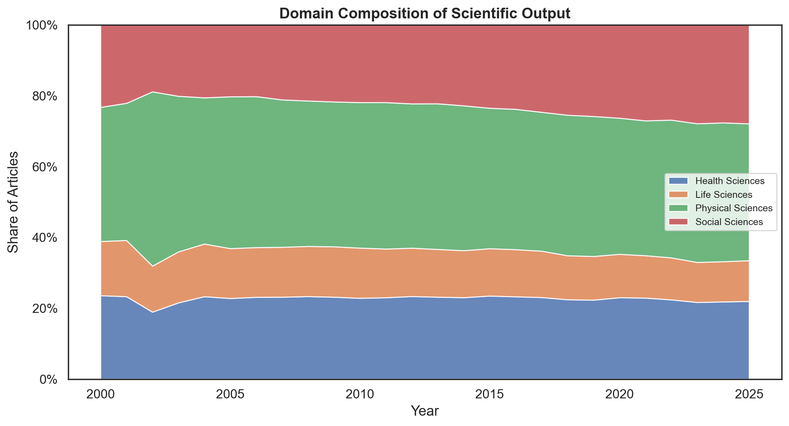
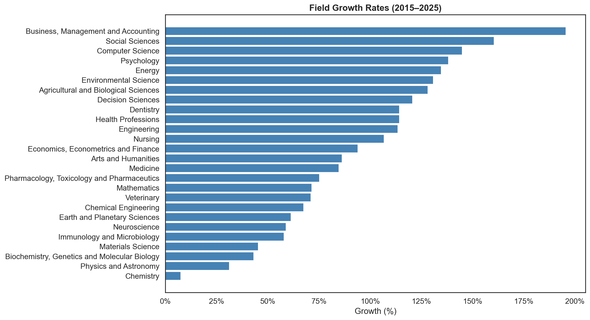
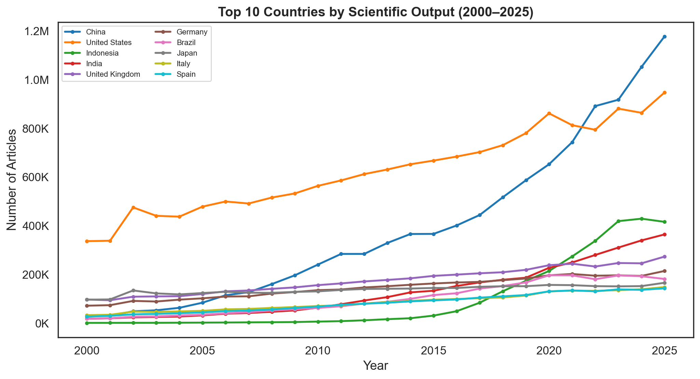
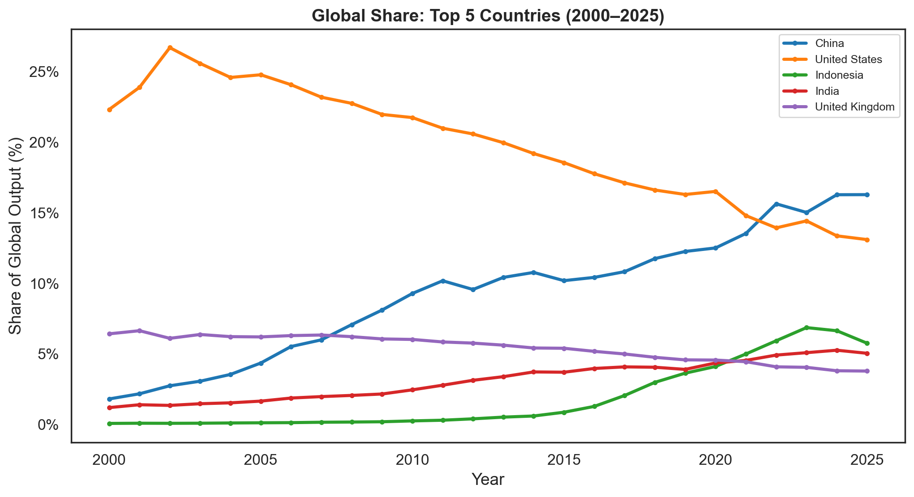

# The Acceleration of Scientific Publishing

---

### Outline
- Science is growing faster than previously documented
- Hanson et al. (2024) report ~47% cumulative growth (~1.92M to ~2.82M articles) and ~5.6% year-on-year exponential growth in journal articles between 2016 and 2022 using Scopus (filtered to Web of Science-indexed journals). These are the two most widely used bibliometric databases, but both are proprietary. Reproducibility requires open alternatives. We repeat the analysis using OpenAlex, an independent open database. Our data show +48.1% cumulative growth and 6.8% mean year-over-year growth over the same window.
- Extending through 2025, we find the mean year-over-year growth rate has risen from 6.8% (2016–2022) to 8.3% (2022–2025), with 2025 alone at +11.9%
- We decompose global publication output by discipline and country. Social Sciences grew fastest (+139.3%, 2015–2025) while Physical Sciences added the most articles (+1.36M). China is now the world's largest producer (1.18M articles, 16.3% of global share) and the US has fallen to second in both absolute volume and global share (947K, 13.1%). 
- Over the last decade (2010–2025), China's added volume (+811K articles) exceeded the total 2025 output of every other country, with the exception of only the US (947K) and China itself (1.18M).

### 1. Introduction
- The volume of scientific literature is growing
- Hanson et al. (2024) documented that articles indexed in Scopus (filtered to Web of Science-indexed journals) grew ~47% from 2016 to 2022 (~1.92M to ~2.82M articles), outpacing researcher growth and straining the peer review system
- This work addresses three open questions:
  1. **Can we validate Hanson et al. using a fully open data source?** We repeat the analysis with OpenAlex to determine whether it may be used as a proxy for growth. 
  2. **How has growth changed since 2022? Overall?** We extend the cumulative growth and year-over-year analysis through 2025, and compute growth over the full 2000–2025 period.
  3. **Where is the growth coming from?** Decomposing by discipline and country identifies which sectors of science are driving the acceleration.


### 2. Methods

Data were retrieved from the [OpenAlex API](https://api.openalex.org) (Priem et al., 2022) in March 2026. See `src/fetch_openalex.py` for the full query logic and the CSVs in `data/`. Results are restricted to `type:article, has_doi:true`. The DOI filter restricts results to DOI-indexed works (registered through providers such as Crossref and DataCite). Countries are assigned via `authorships.institutions.country_code` using whole counting: a paper co-authored by researchers in the US and China counts once for each country. Country shares use total articles per year as the denominator.

Growth metrics are computed as follows:

- **Year-over-year (YoY) growth rate**: (C_t − C_{t−1}) / C_{t−1} × 100, where C_t is the article count in year t
- **Cumulative growth**: (C_end − C_start) / C_start × 100 over a given window
- **Mean YoY rate**: arithmetic mean of annual YoY rates over the window
- **Country share**: country article count / total global articles × 100 for each year
- **Exponential trend** (Figure 1): log-linear OLS fit, ln(C) = a + b·t, where b represents the fitted annual growth rate

To reproduce:

```
pip install -r requirements.txt
python src/fetch_openalex.py   # fetch data from OpenAlex
python src/analyze.py          # print summary statistics
python src/plot.py             # generate figures
```

### 3. Results

#### 3.1 Global article output grew from 1.51M to 7.23M between 2000 and 2025
- Total DOI-indexed articles rose from 1,508,675 in 2000 to 7,233,887 in 2025, a 4.8× increase and +379.5% cumulative growth. The fitted exponential rate is 6.4%/yr



#### 3.2 OpenAlex data validates prior work (48.1% vs 47% cumulative growth in 2016–2022)
- Hanson et al. reported 47% cumulative growth (from 1.92M to 2.82M articles) and 5.6% year-on-year exponential growth using Scopus filtered to WoS-indexed journals 
- We use OpenAlex data over the same 2016–2022 window and find comparable cumulative growth (48.1% from 3.85M to 5.70M articles) and a fitted exponential rate of 6.9%/yr
- OpenAlex's higher absolute counts reflect known differences in corpus size (Maddi et al., 2025; Culbert et al., 2025)
- Despite differences in absolute levels, growth rates align closely (47% vs 48.1% cumulative), indicating that relative changes in volume are comparable

#### 3.3 Growth has accelerated since 2022: mean YoY rate rose from 6.8% to 8.3%
| Year | Articles | YoY Growth |
|------|----------|------------|
| 2022 | 5,701,659 | +3.8% |
| 2023 | 6,108,201 | +7.1% |
| 2024 | 6,464,543 | +5.8% |
| 2025 | 7,233,887 | +11.9% |

- Over the full 2000–2025 period there was +379.5% cumulative growth from 1.51M to 7.23M articles
- Compared to the 2016–2022 window (mean YoY 6.78%), the 2022–2025 window saw +26.9% cumulative growth, and a higher mean YoY rate of 8.29%
- The 2025 figure of +11.9% is the highest single-year growth rate in the DOI-indexed record since 2002 (+25.6%, perhaps reflecting early-2000s digitization catch-up)



#### 3.4 Social Sciences grew fastest (+139.3%); Physical Sciences added the most articles (+1.36M)
- Grouping by domain, all four OpenAlex domains grew from 2015 to 2025, but at different rates:

| Domain | 2015 | 2025 | Growth | Share 2015 | Share 2025 |
|--------|------|------|--------|------------|------------|
| Physical Sciences | 1.41M | 2.78M | +96.4% | 39.6% | 38.6% |
| Social Sciences | 839K | 2.01M | +139.3% | 23.5% | 27.9% |
| Health Sciences | 837K | 1.58M | +88.5% | 23.5% | 21.9% |
| Life Sciences | 477K | 827K | +73.6% | 13.4% | 11.5% |

- Physical Sciences added the most articles in absolute terms (+1,363,414), but Social Sciences grew at the fastest rate (+139.3%). Domain composition has been relatively stable, with the notable exception of Social Sciences, which gained 4.4 percentage points at the expense of the other three domains.







#### 3.5 China surpassed the US in 2022; the Global South now drives the majority of growth
- In 2022, China overtook the US in number of articles (891,175 vs 794,008) and global share (15.6% vs 13.9%). In 2025, it produces 1.24× as many articles (1,177,692 vs 947,239)
- China's output has increased 43× from 27,173 articles in 2000 (1.8% of global) to 1,177,692 in 2025 (16.3%)
- The US's output has increased 2.8× from 336,687 in 2000 (22.3%) to 947,239 in 2025 (13.1%) 
- The fastest growing countries in the 2015-2025 window (that had a minimum 10K articles in 2015) are predominantly from the Global South: Indonesia (+1246%), Pakistan (+433%), Saudi Arabia (+295%), Nigeria (+258%), China (+221%), Ukraine (+196%), Thailand (+187%), Hong Kong (+178%), India (+174%), Turkey (+164%)
- China's increase over this period (from 366K to 1.18M articles) only reflected the fifth highest growth rate, but at its scale, its increase alone exceeded the total 2025 output of 198 of the 200 countries returned by the API query. Only the US and China itself produced more in total than what China added in the last decade.





### 4. Data Limitations
- OpenAlex indexes more broadly than Scopus or WoS. We limit to `type:article, has_doi:true` to restrict results to DOI-indexed works registered through providers such as Crossref and DataCite. Nonetheless, our absolute counts are higher than those of Hanson et al. (2024), who used Scopus filtered to WoS-indexed journals (e.g., 3.85M vs 1.92M articles in 2016). Despite the difference in absolute coverage, our growth rates align.
- The OpenAlex `group_by` API returns a maximum of 200 groups per query. Country-level data is therefore truncated to the top 200 countries per year; the smallest countries are excluded. This does not affect top-country findings but means the total number of publishing countries is slightly understated.

### 5. Conclusion
- We replicate prior work (Hanson et al., 2024) using fully open data and find article output grew +48.1% from 2016 to 2022, consistent with the previously reported ~47%
- Growth in publication volume has accelerated from 6.8% YoY in 2016–2022 to 8.3% YoY in 2022–2025. The 2025 growth rate of +11.9% is the highest in over two decades. Over the last 25 years, global article output has grown 4.8× from 1.51M to 7.23M (+379.5% cumulative growth from 2000 to 2025). 
- The geography of science has also fundamentally shifted. US share fell from 22.3% to 13.1%, China rose from 1.8% to 16.3% and became the top producer in 2022, and the 10 fastest-growing systems are predominantly from the Global South. China's added output over the last decade exceeded every other country's total 2025 output, with the exception of only the US and China itself.
- The scientific community must confront these trends. Peer review, editorial systems, and knowledge synthesis hinge on infrastructure that was designed for a different literature composition and volume. These processes may be under strain as the system continues to accelerate and shift in its geography.
- Quality dimensions, such as citation impact, retraction rates, reproducibility, should be measured to understand how quality is impacted as volume grows.
- All data and code are fully open and reproducible in this repository

### References

Culbert, J. H., Hobert, A., Jahn, N., Haupka, N., Schmidt, M., Donner, P., & Mayr, P. (2025). Reference coverage analysis of OpenAlex compared to Web of Science and Scopus. *Scientometrics*, 130, 2475–2492. doi: 10.1007/s11192-025-05293-3.

Maddi, A., Maisonobe, M., & Boukacem-Zeghmouri, C. (2025). Geographical and disciplinary coverage of open access journals: OpenAlex, Scopus, and WoS. *PLOS ONE*, 20(4), e0320347.

Hanson, M. A., Gómez Barreiro, P., Crosetto, P., & Brockington, D. (2024). The strain on scientific publishing. *Quantitative Science Studies*, 5(4), 823–843. doi: 10.1162/qss_a_00327.

Priem, J., Piwowar, H., & Orr, R. (2022). OpenAlex: A fully-open index of scholarly works, authors, venues, institutions, and concepts. *arXiv preprint*, arXiv:2205.01833.

